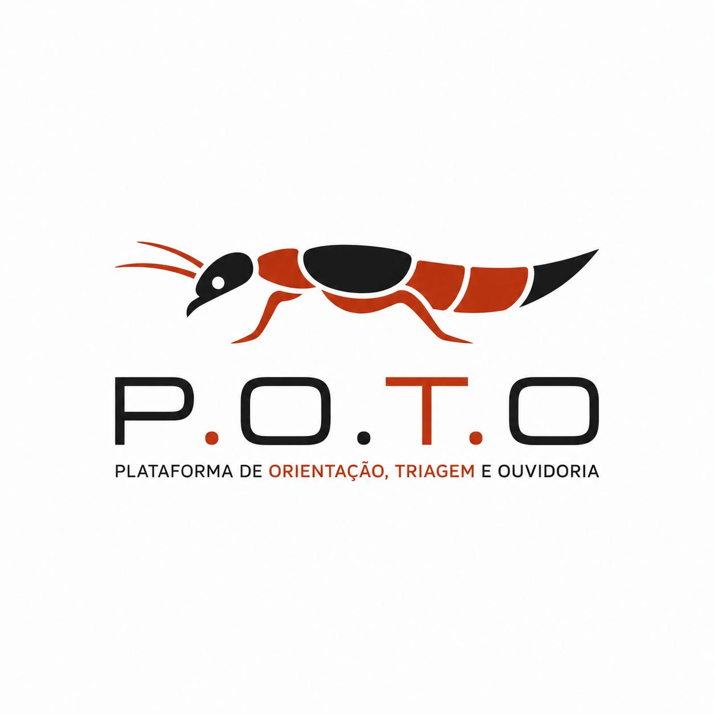
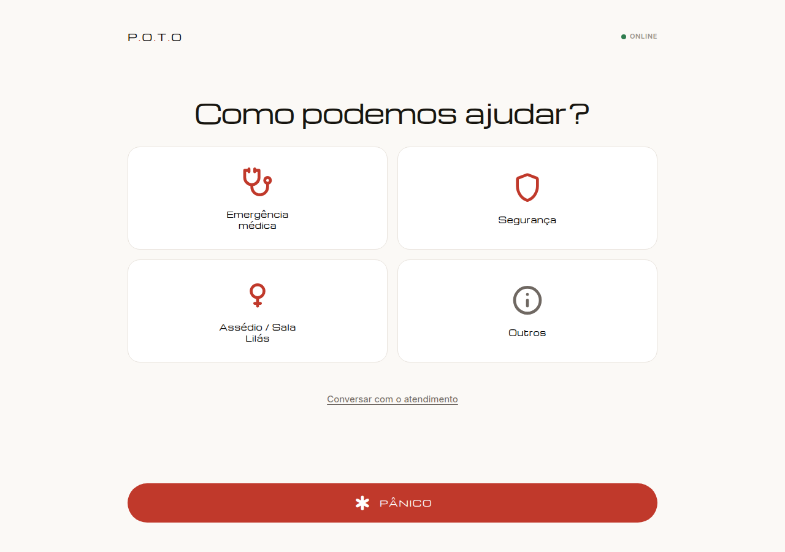
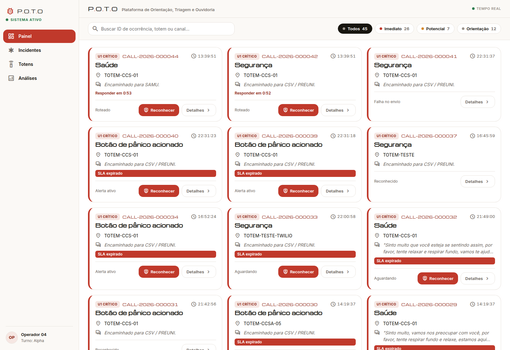
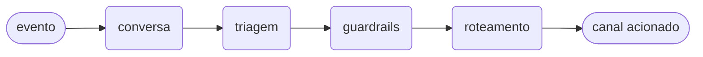

<p align="center">
  
</p>

<h1 align="center">P.O.T.O</h1>

<p align="center">
  <em>Plataforma de Orientação, Triagem e Ouvidoria —<br>
  totem de emergência que continua funcionando quando a internet acaba.</em>
</p>

<p align="center">
  
  
  
  
  
</p>

---

## 📖 Sobre o Projeto

O **P.O.T.O** é um totem de emergência para o campus Ministro Petrônio Portella
da UFPI. Alguém em situação de risco — assédio, mal-estar, ameaça — aperta um
botão, fala ou escreve, e o sistema **classifica o pedido e aciona o canal
certo** (segurança do campus, Sala Lilás, SAMU, Polícia Militar) sem depender
de a pessoa saber para quem ligar.

O problema real não é a falta de canais: a UFPI já tem CSV, Sala Lilás, SAPSI e
Ouvidoria. O problema é que, no momento do susto, **ninguém lembra qual número
disca**, e a hesitação custa minutos. O totem existe para eliminar essa escolha.

Duas restrições moldam quase todas as decisões técnicas daqui:

> **1. Se a rede cair, o totem não pode virar um enfeite.**
> **2. O modelo de linguagem nunca decide sozinho o que é urgente.**

A primeira explica a fila offline, o fallback determinístico e o canal GSM. A
segunda explica o classificador especializado e a validação humana em 3 níveis —
as duas seções mais importantes deste documento.

---

## 🖼️ As telas

**Totem** — a pergunta é "como podemos ajudar?", não "selecione uma categoria".
Quatro alvos grandes o suficiente para serem acertados com a mão trêmula, a
conversa por voz como alternativa a ler qualquer coisa, e o pânico sempre
visível, sem exigir escolha nenhuma.

<p align="center">
  
</p>

**Painel da central** — chamados em tempo real com o **SLA correndo na tela**
(`Responder em 0:53`). Quando o prazo estoura, o cartão ganha a faixa
`SLA expirado` e o escalonamento dispara sozinho — é o fail-safe da seção
anterior, visível. `Falha no envio` marca o que precisa de outro canal.

<p align="center">
  
</p>

> Capturas do protótipo em execução, com dados de teste (`make seed`).

---

## ✨ O que ele faz

### Quatro trilhas de atendimento

Cada trilha tem canal, gravidade e comportamento de interface **diferentes** —
por isso são tipos distintos, e não um "chamado" genérico com campos opcionais.

| | Trilha | Roteia para | Fallback | Gravidade |
|---|---|---|---|---|
| 🚨 | **Segurança** | CSV / PREUNI | Polícia Militar (190) | risco imediato |
| 🟣 | **Mulher** | Sala Lilás *(comercial)* / Central 180 | 180 → PM 190 | risco potencial |
| 🏥 | **Saúde — emergência** | SAMU 192 | CSV / PREUNI | risco imediato |
| 💬 | **Saúde — apoio** | SAPSI / PRAEC *(comercial)* | Ouvidoria | orientação |
| 📣 | **Ouvidoria** | Ouvidoria UFPI / Fala.BR | — | orientação |

O roteamento é **sensível ao horário**: fora do expediente, Sala Lilás e SAPSI
não têm quem atenda, então o pedido vai direto para o canal estadual (180) ou
fica registrado para o dia seguinte. Um encaminhamento para uma sala vazia às
2h da manhã é o mesmo que não encaminhar.

### Modo discreto

A trilha da mulher é **sempre discreta**, sem opção de desligar. Na prática:

- a tela mostra só `"Seu pedido foi enviado. Aguarde atendimento."` — nunca o
  canal acionado, nunca a palavra "denúncia";
- **sem feedback sonoro** — nenhum bipe denuncia que o botão foi usado;
- a câmera e a conversa por voz **não são iniciadas automaticamente**.

O raciocínio é direto: se o agressor está a três metros, uma tela que anuncia
"Sala Lilás acionada" transforma o socorro em risco.

### Botão de pânico

Um botão físico (arcade, GPIO) dispara um chamado sem qualquer interação de
tela. O status vira `alerta_ativo` — que, diferente dos outros, **é persistente
e não fecha sozinho** até alguém atender de fato.

---

## 🧠 Como o sistema decide (validação humana em 3 níveis)

Este é o coração do projeto. A pergunta que ele responde é: *quando a máquina
pode agir sozinha, e quando ela precisa de um humano?*

Responder "sempre precisa de humano" mata o propósito do totem — o operador
vira gargalo e a resposta atrasa. Responder "nunca precisa" é irresponsável com
um sistema que aciona polícia. A saída foi classificar o **regime de autonomia**
de cada chamado:

| Nível | Quando | O que acontece | Humano é gate? |
|---|---|---|---|
| 🔴 **claro** | sinal crítico, risco imediato | **aciona já**, humano acompanha | ❌ não bloqueia |
| 🟡 **suposto** | risco potencial, ameaça difusa, baixa confiança | aguarda validação do operador | ✅ sim — **com timeout** |
| 🟢 **normal** | orientação, confiança alta | o bot conduz e encaminha sozinho | ❌ não precisa |

O detalhe que faz o nível `suposto` funcionar é o **fail-safe protetivo**: o
chamado fica em `pendente_validacao`, mas se o operador não responder dentro do
prazo, **ele escala sozinho**. O timeout nunca resolve a favor do silêncio.

```
suposto ──► pendente_validacao ──┬── operador confirma ──► aciona canal
                                 ├── operador descarta ──► encerra
                                 └── ninguém responde ───► ESCALA (fail-safe)
```

A mesma lógica governa o SLA dos chamados já notificados: sem ACK em **2 min**
(risco imediato) ou **10 min** (risco potencial), o sistema escalona para o
canal de fallback automaticamente.

---

## ⚡ Por que um classificador, e não um LLM

A intuição diz "use um modelo de linguagem, ele entende português". A medição
diz outra coisa. No conjunto held-out (`scripts/bench_dataset.json`):

| Abordagem | acurácia (tipo) | acurácia (gravidade) | latência | onde roda |
|---|---|---|---|---|
| qwen2.5:0.5b | 29% | 27% | ~5800 ms | CPU do Pi 5 |
| qwen2.5:1.5b | 45% | 48% | ~6100 ms | CPU do Pi 5 |
| llama3.2:3b | 86% | 60% | ~2000 ms | workstation |
| **classificador especializado** | **83%** | **86%** | **~6 ms** | qualquer CPU |

TF-IDF (palavra + caractere) + Regressão Logística sobre frases pt-BR rotuladas.
**Mil vezes mais rápido, mais preciso na gravidade** — que é justamente a
variável que decide se chama o SAMU — e com footprint de poucos KB.

Os LLMs pequenos que caberiam no Pi são ruins demais para essa decisão; os bons
não cabem. O classificador resolve o impasse: ele **governa** a triagem, e o LLM
(local ou remoto) entra só como refino opcional da conversa, **sem poder de
rebaixar** a classificação.

Os n-gramas de caractere não são detalhe: com poucos dados rotulados, eles dão
robustez a erros de digitação e variação morfológica — "socorroo", "tão me
seguindo", "passando maal" continuam caindo no lugar certo.

> Degradação graciosa: sem `scikit-learn` ou sem o modelo treinado,
> `disponivel()` retorna `False` e o pipeline cai na heurística/LLM.
> Detalhes e reprodução em [`docs/inferencia.md`](docs/inferencia.md).

---

## 🏗️ Arquitetura

```
frontend/ (Bun + TS)                  backend/ (FastAPI + uv)
  totem  (kiosk, online/offline) ── HTTP/WS ──►  API de eventos
  painel (tempo real)                            Classificador (TF-IDF+LogReg)
                                                 Roteador determinístico
                                                 Agentes (LangGraph + Ollama)
                                                 SQLite + fila de notificação
```

O fluxo agêntico, exportável com `make graph`:



### As três camadas de resiliência

O sistema foi desenhado para degradar em etapas, nunca de uma vez:

| Se falha… | O que ainda funciona |
|---|---|
| **Ollama / LangGraph** | roteamento crítico segue por regras (`router_engine.py`) |
| **Internet** | service worker + fila local; envio idempotente por UUID |
| **Rede inteira** | canal GSM/2G via SIMCom A7670SA — voz e SMS reais |

O envio offline é **idempotente**: cada evento carrega um UUID gerado no totem,
então drenar a fila duas vezes não gera dois chamados. É o tipo de detalhe que
não aparece na demo, mas é a diferença entre uma fila confiável e uma fila que
duplica alarme de emergência.

---

## 🎙️ Voz e 📹 vídeo

### Dois modos de voz

- **Conversa hands-free** — VAD capta a fala → Whisper transcreve
  (`/transcrever`) → o agente decide a próxima pergunta ou conclui
  (`/conversa`) → resposta falada em TTS pt-BR → repete. Em sinal crítico
  conclui de imediato e escala; senão, faz até ~3 perguntas de acolhimento.
- **Descrever por voz** — grava uma fala única, transcreve, preenche o campo.

A orbe do microfone tem estados visuais explícitos, porque um usuário em pânico
não interpreta ambiguidade:

| Estado | UI | Quando |
|---|---|---|
| ocioso | respiração lenta | pronto para gravar |
| solicitando | pulso curto | pedindo permissão do microfone |
| recebendo | anel reativo ao volume | gravando |
| processando | anel tracejado girando | enviando/transcrevendo |
| concluído | tom verde + ✓ | transcrito |
| erro | tom ferrugem + tremor | permissão negada / falha de rede |

> A captura de áudio funciona sempre. A **transcrição** exige STT local:
> `make stt-setup` e `POTO_STT_PROVIDER=faster-whisper` no `backend/.env`.
> Sem provedor, a UI pede o texto digitado — **nenhuma fala sai da máquina**.

### Vídeo

- **Transmissão ao vivo (WebRTC):** o backend faz só a sinalização (SDP/ICE) em
  `ws /api/v1/rtc/{sala}`, com `sala = chamado_id`. O vídeo trafega
  peer-to-peer; a central vê "● vídeo ao vivo" no chamado.
- **Evidência:** ao encerrar, o clipe vai para `POST /api/v1/evidencia` e é
  salvo com metadados.

> Requer **contexto seguro**: funciona em `localhost`; em rede/IP, use HTTPS
> (exigência do `getUserMedia`). No modo discreto o vídeo não inicia sozinho.

---

## 🚀 Como rodar

Pré-requisitos: [`uv`](https://docs.astral.sh/uv/), [`bun`](https://bun.sh) e,
opcionalmente, [`ollama`](https://ollama.com).

```bash
make setup            # uv sync + bun install
make agents-pull      # baixa o modelo (llama3.2:3b) — opcional
make seed             # chamados de exemplo — opcional
make dev              # backend :8000 + frontend :5173
```

| | URL |
|---|---|
| 🖥️ Totem | http://localhost:5173/ |
| 📊 Painel | http://localhost:5173/painel |
| 📘 API / Docs | http://localhost:8000/docs |

Para ativar o classificador especializado (recomendado):

```bash
cd backend && uv sync --extra clf   # dependência opcional (scikit-learn)
cd .. && make train-clf             # treina e salva o artefato
```

### Modo standalone (Pi offline)

Se `frontend/dist` existir, o backend serve a PWA em `/app` — um totem único
rodando tudo localmente, sem servidor externo:

```bash
make build-frontend && make backend
# totem: http://localhost:8000/app/index.html
```

---

## 🛠️ Alvos do Makefile

| Comando | O que faz |
|---|---|
| `make backend` | Sobe só a API (uvicorn, reload) |
| `make frontend` | Builda e serve só a PWA |
| `make doctor` | Verifica ferramentas, agentes, STT, câmera, microfone, serviços |
| `make agents-check` | Mostra se está em modo `agentes` ou `heuristica` |
| `make studio` | Abre o **LangGraph Studio** (visualiza e testa o fluxo) |
| `make graph` | Exporta o grafo em Mermaid → `docs/agent-graph.mmd` |
| `make bench` | Compara abordagens de inferência (tabela acima) |
| `make train-clf` | Treina o classificador especializado de triagem |
| `make stt-setup` | Instala o Whisper local (faster-whisper) |
| `make smoke` | Roteia um evento sem subir servidor |
| `make selftest` | Auto-teste modular: cada componente isolado (PASS/FAIL/SKIP) |
| `make rtc-smoke` | Smoke-test da sinalização WebRTC |
| `make test` | Testes do backend (pytest) |
| `make acceptance` | Critérios de aceite automatizados (§8 do protótipo) |
| `make clean` | Remove `dist/`, venv e banco local |

### Visualizar o fluxo agêntico

```bash
make studio     # servidor local em http://127.0.0.1:2024
```

Abra a **Studio UI** (`https://smith.langchain.com/studio/?baseUrl=http://127.0.0.1:2024`),
informe o input e acompanhe a execução **nó a nó**:

```json
{ "texto": "um homem está me seguindo perto do bloco 7", "modo": "normal" }
```

Compare caminhos editando o texto — um sinal crítico leva a
`escalonar_humano = true`. Para testar sem login, `make graph` gera o Mermaid
offline.

---

## ⚙️ Configuração

Variáveis em `backend/.env` (partindo de `.env.example`):

<details>
<summary><strong>IA e inferência</strong></summary>

| Variável | Padrão | Descrição |
|---|---|---|
| `POTO_AGENTS_ENABLED` | `true` | Liga/desliga a camada de IA |
| `POTO_OLLAMA_MODEL` | `llama3.2:3b` | Modelo do Ollama |
| `POTO_OLLAMA_URL` | `http://localhost:11434` | Endpoint do Ollama |
| `POTO_STT_PROVIDER` | `faster-whisper` | `none` ou `faster-whisper` |
| `POTO_WHISPER_MODEL` | `base` | `tiny`/`base`/`small`… |
| `POTO_DB_PATH` | `backend/poto.db` | Caminho do SQLite |

</details>

<details>
<summary><strong>Notificação e canais</strong></summary>

| Variável | Padrão | Descrição |
|---|---|---|
| `POTO_NOTIF_PROVIDER` | `log` | `log`, `webhook`, `telegram`, `twilio` |
| `POTO_CONTACT_OVERRIDE` | — | Redireciona **todos** os alertas (testes) |
| `POTO_NOTIF_WEBHOOK_URL` | — | Webhook (Evolution API, n8n…) |
| `POTO_TWILIO_ACCOUNT_SID` | — | Account SID Twilio |
| `POTO_TWILIO_AUTH_TOKEN` | — | Auth Token (**nunca commitar**) |
| `POTO_TWILIO_FROM` | — | Número remetente E.164 |
| `POTO_TWILIO_MODE` | `voice` | `voice` (liga e fala) ou `sms` |
| `POTO_SLA_CHECK_INTERVAL` | `30` | Segundos entre verificações de SLA |

</details>

<details>
<summary><strong>Vídeo e evidência</strong></summary>

| Variável | Padrão | Descrição |
|---|---|---|
| `POTO_EVIDENCIA_ENABLED` | `true` | Liga o registro de evidência |
| `POTO_EVIDENCIA_DIR` | `backend/evidencias` | Pasta das evidências |
| `POTO_STUN_URL` | `stun:stun.l.google.com:19302` | STUN (LAN dispensa) |
| `POTO_TURN_URL` / `_USER` / `_PASS` | — | TURN (só para NAT simétrico) |

</details>

No frontend, o endpoint da API pode ser sobrescrito em `localStorage.poto_api`.

### Privacidade no payload

A notificação externa carrega o **mínimo** exigido para agir: protocolo, tipo,
gravidade e totem. **O relato nunca sai** — quem precisa do conteúdo consulta o
painel autenticado. É requisito de LGPD, mas também é bom senso: um SMS
interceptado não pode expor o depoimento de uma vítima.

---

## 📡 Hardware

| Item | Modelo |
|---|---|
| Controlador | Raspberry Pi 5 — 8 GB |
| Câmera | Pi Camera Module 3 Wide **ou** Logitech C920 |
| Microfone | Array USB **ou** embutido na C920 |
| Tela touch | Pi Touch Display 2 (7") **ou** HDMI + touch USB |
| Botão pânico | Arcade 60 mm + jumpers GPIO |
| Fonte | USB-C PD 27 W oficial |
| Conectividade de contingência | SIMCom A7670SA (GSM/2G — voz e SMS) |

⚠️ O A7670SA **não tem VoLTE**: a voz só sai por fallback 2G/GSM, o que exige
cobertura 2G no local. SMS funciona em LTE Cat-1 ou GSM. E o `AT+CTTS` do chip
fala só chinês e inglês — para pt-BR na ligação, toca-se o WAV do Piper pela
linha de áudio.

Montagem completa: [`docs/hardware-pi.md`](docs/hardware-pi.md) ·
[`docs/hardware-simcom.md`](docs/hardware-simcom.md)

---

## 📁 Estrutura

```
backend/app/
  main.py             API FastAPI (eventos, pânico, triagem, conversa, RTC)
  classificador.py    TF-IDF + LogReg — o "governante" da triagem
  router_engine.py    roteamento determinístico (horário, trilha, fallback)
  agents/graph.py     LangGraph: conversa → triagem → guardrails → roteamento
  models.py           domínio (trilhas, gravidade, status, níveis de risco)
  sla.py              escalonamento por timeout (fail-safe)
  notifier.py         adapters: log · webhook · telegram · twilio
  simcom.py           canal GSM/2G
  stt.py · voz.py · video.py

frontend/src/
  totem.ts            kiosk (online/offline, modo discreto)
  painel.ts           central em tempo real
  voice.ts · audio.ts · video.ts · chat.ts
```

---

## 📚 Documentação

| Documento | Assunto |
|---|---|
| [`docs/inferencia.md`](docs/inferencia.md) | Por que o classificador governa a triagem |
| [`docs/relatorio-poto.html`](docs/relatorio-poto.html) | Documentação de produto |
| [`docs/relatorio-prototipo.html`](docs/relatorio-prototipo.html) | Relatório do protótipo e stack |
| [`docs/hardware-pi.md`](docs/hardware-pi.md) | Montagem do totem físico |
| [`docs/hardware-simcom.md`](docs/hardware-simcom.md) | Canal GSM/2G |
| [`docs/demo-twilio.md`](docs/demo-twilio.md) | Demonstração com ligação real |
| [`docs/teste-ollama-remoto.md`](docs/teste-ollama-remoto.md) | Ollama em servidor remoto |
